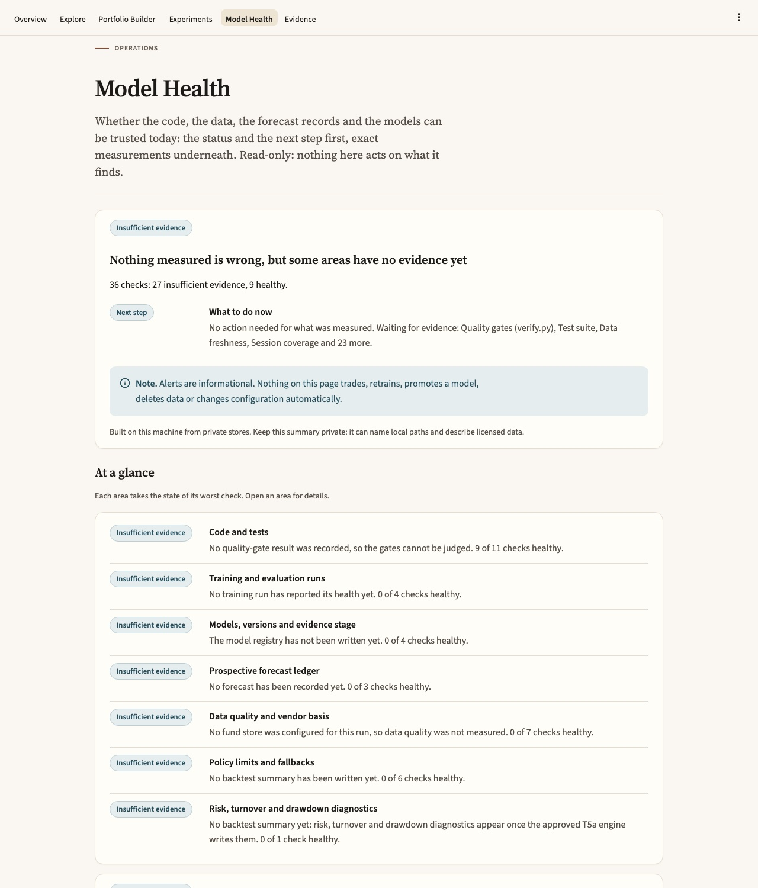
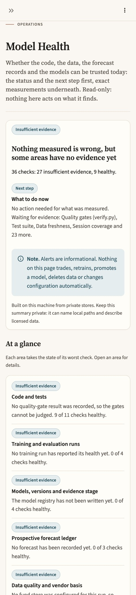
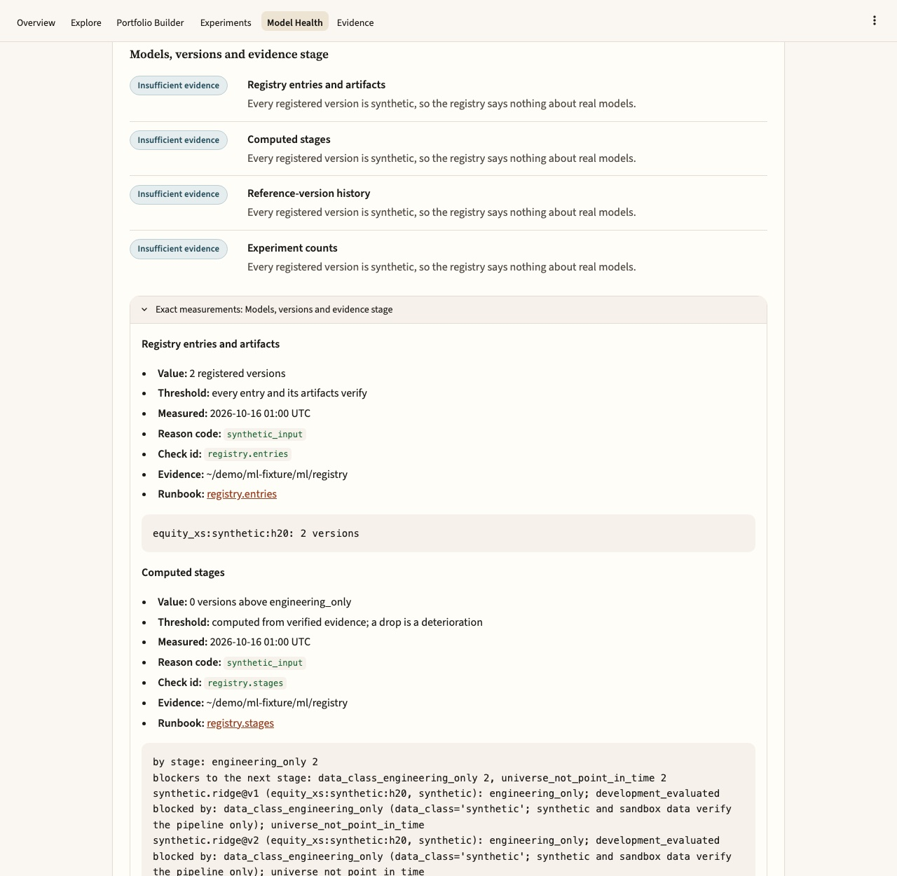
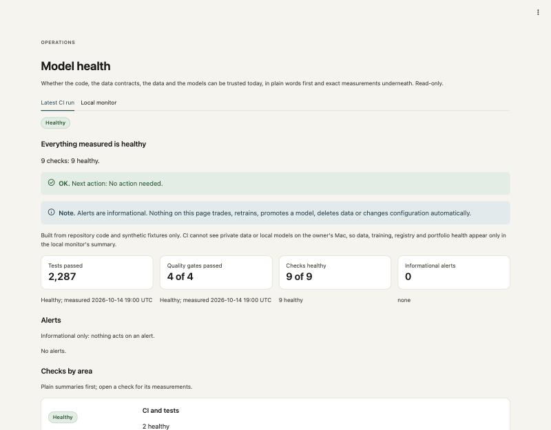
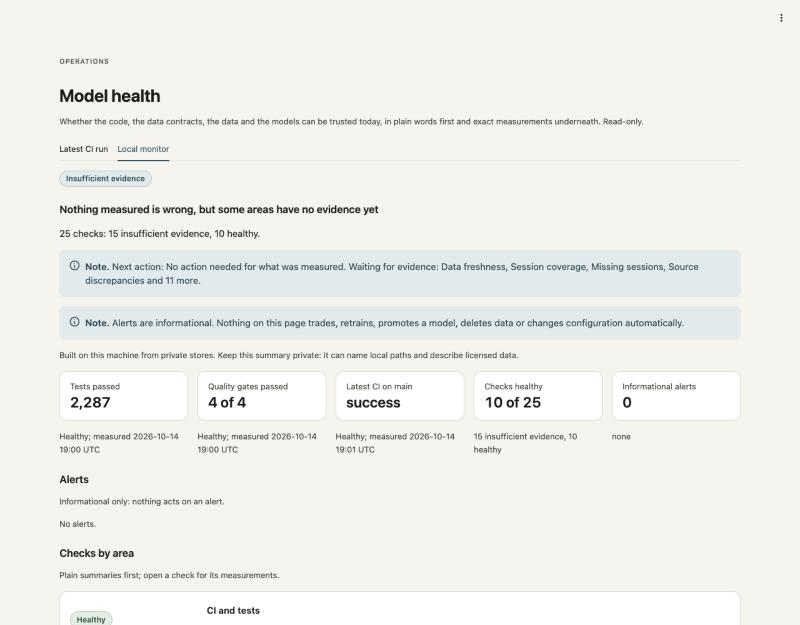

# Model Health Center

Whether the code, the data contracts, the data and the models can be trusted
today, as machine-readable summaries and a page that reads them. The
operator guide for each check is the [runbook](runbook.md).

Code: `src/stock_agent/health/`. Scripts: `scripts/health_check.py` (build a
summary), `scripts/setup_health_schedule.py` (prepare the private daily
schedule), `scripts/run_portfolio_lab.py` (the Lab's Model Health page) and
`scripts/run_model_health.py` (the technical page). Workflow:
`.github/workflows/health.yml`. Tests: `tests/test_health_*.py` and the
Model Health tests in `tests/test_app_destinations.py`.

## Principles

- **Never healthy without a measurement.** A check is healthy only with a
  measured value and a measurement time; a summary without checks is
  `insufficient_evidence`.
- **Informational only.** Alerts are messages. Nothing in the health center
  trades, retrains, promotes, deletes or changes configuration, and the
  summary format itself refuses any other `automatic_action` than `none`.
- **Read-only towards what it monitors.** Monitors flag; they never modify,
  fill, drop or adjust data (AGENTS.md, anomaly-detection hierarchy).
- **Public and private stay apart.** GitHub Actions sees only repository
  code and synthetic fixtures. Private stores, licensed data and local
  models are read only by the local monitor on the owner's Mac, whose
  summaries never leave it. CI cannot inspect the owner's Mac and nothing
  here pretends otherwise.
- **No network, with one opt-in exception.** Nothing in `stock_agent.health`
  makes a request itself. The local monitor, when run with `--github`,
  records the latest GitHub Actions runs with the owner's GitHub CLI
  (`gh run list`, read-only public run metadata; `health.github`). Without
  it, or without a working `gh`, the run checks are `insufficient_evidence`.
  The Portfolio Lab never makes a network call.
- **The prospective boundary holds.** Research code may not import the
  prospective store, its rules calendar or its collector
  (`tests/test_prospective_boundaries.py`). The health checks for the
  prospective track therefore receive the store's reader, the rules
  calendar and the anchors loader from `scripts/health_check.py`, a reviewed
  consumer, and keep only counts, dates, ids and hashes: never a close or
  an amount.
- **Point-in-time.** Data monitors judge a store as of the run time and
  count only batches retrieved by then; freshness is measured against the
  lockbox cap, never against today.

## States and precedence

Worst first; the overall state is the first state any check has:

| State | Meaning |
|---|---|
| `failed` | Measured, and a hard limit or contract is broken |
| `unavailable` | A measurement that should exist could not be taken (unreadable input, a tool that did not run). It can hide a failure, so it outranks `degraded` |
| `degraded` | Measured, outside a warning threshold, still usable |
| `insufficient_evidence` | Nothing to judge yet: the input does not exist (another track has not delivered), or there are too few observations |
| `healthy` | Measured, within its threshold |

A check that does not apply to what was measured (interval coverage of a
point forecast) is not given a state: it is listed under `not_applicable`,
shown on the page, and never counts towards the overall state.

`insufficient_evidence` ranks above `healthy` on purpose: while any area has
no evidence, the overall state cannot be healthy. The page says so in plain
words ("nothing measured is wrong, but some areas have no evidence yet") and
lists what it is waiting for.

**Conditions** (`stock_agent.health.model.Condition`). The page, the
console output and the scheduler's `--status` name each check by its
condition, derived from its stored state and reason, so "no evidence",
"not activated", "stale" and "failed" never share a word. The summary
format is unchanged: a reader derives the same condition from the same
state and reason.

| Condition | Word | From |
|---|---|---|
| `failed`, `unavailable` | Failed, Unavailable | the state |
| `degraded` | Degraded | `degraded`, any reason but staleness |
| `stale` | Stale | `degraded` with `stale_data`, `stale_evidence`, `stale_prices` or `daily_run_overdue` |
| `no_evidence` | Insufficient evidence | `insufficient_evidence`, any reason but `not_authorized` |
| `not_activated` | Not activated | `insufficient_evidence` with `not_authorized` (a job not authorized yet) |
| `healthy` | Healthy | the state |

Conditions keep the state precedence (every condition of a worse state is
worse), so the worst condition always belongs to the overall state. A test
holds every `stale_*` reason a check emits to the stale condition.

## The summary (schema 1.0)

One strict-JSON file (no NaN, no duplicate keys), refused as a whole by the
reader (`stock_agent.health.model.read_summary`) on any defect:

```text
format          "stock_agent.health_summary"
schema_version  "1.0"
generated_at    UTC, microseconds, "Z"
code_sha        40-hex or null        the producer's claim, not authenticated
code_dirty      true/false or null    any change or untracked file except .venv
scope           "synthetic" (public-safe) | "private" (owner's machine)
run_context     {"environment": "local"} or allowlisted GitHub Actions metadata
precedence      the five states, worst first
overall_state   recomputed by the reader and compared
state_counts    recomputed by the reader and compared
alert_policy    "informational_only"
checks          [check, ...]
not_applicable  [{check_id, area, title, reason, detail}, ...]  no state; never counted
alerts          [alert, ...]
```

Each check: `check_id` (`<area>.<name>`), `area`, `title`, `state`, `reason`
(machine-readable; required unless healthy), `measured_at`, `value`, `unit`,
`threshold`, `better` and `tolerance` (for deterioration), `summary` (plain
words), `detail` (technical), `runbook` (an anchor in the runbook) and
`evidence` (a path relative to the summary, an absolute path in private
summaries, or a `fixture:` / `module:` reference).

Each alert: `alert_id` (`<kind>:<check_id>`), `kind` (`failure`,
`constraint_violation`, `unavailable_data`, `degraded`, `deterioration`),
`check_id`, `state`, `message`, `raised_at`, `automatic_action: "none"`.

`run_context` in GitHub Actions copies only `GITHUB_WORKFLOW`,
`GITHUB_RUN_ID`, `GITHUB_RUN_NUMBER`, `GITHUB_RUN_ATTEMPT`,
`GITHUB_EVENT_NAME`, `GITHUB_REF_NAME`, `GITHUB_SHA`, `GITHUB_REPOSITORY` and
`RUNNER_OS`, each checked against a strict pattern, plus the run URL. No
token, secret or other variable is read.

## Checks

| Area | Check | Where | Source |
|---|---|---|---|
| CI and tests | `ci.verify`, `ci.tests` | CI and local | `scripts/verify.py` output (run, or an existing log) |
| | `ci.main_runs`, `ci.daily_health` | local | `gh run list` for `ci.yml` and `health.yml` on `main` (`--github`), or a list the owner wrote (`--ci-runs`) |
| Dependencies | `deps.pins`, `deps.pip_check` | CI and local | `requirements.txt`, the running interpreter, `pip check` |
| Contracts | `contract.publication`, `contract.fund_data`, `contract.generators` | CI and local | probes on synthetic fixtures in a temporary directory |
| Self-tests | `smoke.data_monitors`, `smoke.input_readers` | CI and local | the monitors and readers on planted synthetic defects |
| Data quality | `data.freshness`, `data.coverage`, `data.missing_sessions`, `data.vendor_discrepancy` | local | a private F1 fund store |
| Vendor basis | `data.anchors`, `data.store_batches`, `data.window_coverage` | local | the anchors file, and the prospective store through its reader (passed in by the script) |
| Training | `training.health`, `training.ml_runs` | local | the newest training-health input; the experiment runner's `reports/ml/ledger.jsonl` |
| Registry | `registry.entries`, `registry.stages`, `registry.selection_history`, `registry.experiments` | local | the ML track's model registry, through its read API |
| Forecasts | `forecast.coverage`, `forecast.calibration` | local | the newest registry export's forecast evaluations |
| Forecast ledger | `forecast.ledger`, `forecast.ledger_backup`, `forecast.ledger_sessions`, `forecast.ledger_scores` | local | the prospective ledger (the job's own reader), the owner's kept head copy, the rules calendar; `forecast.ledger_scores` counts matured forecast rows without a score |
| Portfolio | `portfolio.turnover`, `portfolio.costs`, `portfolio.concentration`, `portfolio.drawdown` | local | the newest backtest summary per policy (the worst policy decides; each keeps its own line) |
| Policy safety | `portfolio.violations`, `portfolio.fallbacks`, `portfolio.diagnostics` | local | the newest backtest summary per policy and the newest RL evaluation report |
| Stock Lab | `data.stock_lab_freshness`, `data.stock_lab_tickers`, `forecast.stock_lab_job`, `forecast.stock_lab_scores`, `forecast.stock_lab_drift`, `forecast.stock_lab_ledger` | local | the newest `stock_lab_monitor` file written by the Stock Lab's daily job (experimental, unvalidated forecaster; tracking only); `data.stock_lab_tickers` reads each watched ticker's provider-listing status |

Thresholds are operator defaults written in the code next to each check and
in the runbook; they are not owner-approved policy and change together. The
monitor self-tests exist because a green data check means nothing unless the
monitor would have turned red on a real defect: in CI there is no real data,
so CI checks the monitors instead of the data.

## Inputs from other tracks (agreed formats v1.0, 2026-10-14)

Agreed with the lead on 2026-10-14. Producers own their check statuses;
health recomputes nothing, never shows healthy without a measurement, and
reports `insufficient_evidence` until an input exists. Worked examples:
`stock_agent.health.fixtures`.

**Location.** Producers write `reports/health_inputs/<artifact>/<run_id>.json`
(ignored by Git). The local monitor reads the newest file per artifact by
`generated_at` (backtest summaries: the newest per `policy`, so every policy a
run writes is judged); unreadable files beside a readable one are named and
make the check at least degraded. CI reads only the synthetic fixtures.

**Envelope** (one strict-JSON object; extra fields are ignored):

```text
artifact        "rl_training_health" | "model_registry" | "backtest_summary"
                | "stock_lab_monitor"
schema_version  "1.0"
generated_at    "YYYY-MM-DDTHH:MM:SS.ffffffZ"
code_sha        40-hex or null
synthetic       true | false
run_id          text, equal to the file name
```

**Transition status.** Every artifact that depends on portfolio economics
(training health, backtest summaries) carries `transition_status`:
`"approved"` or `"engineering_only_unapproved_transition"`. The second is
shown as a visible limitation (`degraded`, reason `unapproved_transition`),
never as a failure of the run itself.

- **Training health** (RL track): `algorithm`, `status` (`completed` |
  `running` | `failed`), `seeds`, `scenario_version`, `transition_status`,
  `checks` `[{check_id, status: pass|warn|fail|not_run, value, unit,
  threshold, detail}]`. The listed check ids are `nan_or_inf`,
  `exploding_values`, `approx_kl`, `clip_fraction`, `entropy_collapse`,
  `value_loss`, `reward_trend` and `seed_spread`; a missing listed id counts
  as `not_run`, and extra ids are shown.
- **Model registry export** (ML track): `models` `[{model_id, version, stage,
  stage_basis, registered_at}]`, `selection_events`, `experiments`,
  `forecast_evaluation` `[{model_id, version, horizon, forecast_kind:
  point|interval|probabilistic, interval_level, observed_coverage, n,
  calibration_status, calibration_detail}]`. The registry stays the source of
  truth: the `registry.*` checks read it through
  `stock_agent.registry.open_registry` (docs/research/ml_registry.md), which
  re-verifies entries, events and artifacts and computes stages; health only
  reads the export's forecast evaluations. Point forecasts carry null
  interval fields and `not_run`; they are named "not applicable: point
  forecast" and never count, and an export of point forecasts only lists the
  forecast checks as **not applicable** (the summary's `not_applicable`
  list) rather than giving them a state.
- **Backtest summary** (the T5a engine or the RL comparison harness):
  `evidence_status`, `policy`, `transition_status`, `constraints`
  `{max_turnover, max_cost_bps, max_weight, max_drawdown}`, `measures`
  `{turnover, costs_bps, max_weight, max_drawdown}`, optional `units`.
  Measures come from the approved T5a formulas only; health compares stored
  numbers and never recomputes turnover, cost or drawdown (OD8).
  Optional additions read by the policy checks (a summary without them
  leaves those checks `insufficient_evidence`): `constraint_violations` and
  `fallback_events` (integers >= 0), `fallback_reasons` `{reason: int}`, and
  `measures.volatility` (the risk measure, once its formula is approved).
  Optional, informational, not read by any check (added 2026-10-17, schema
  still "1.0"): `build`, the build's executed weights, uninvested cash and
  incomplete construction (`portfolio.construction`, the owner's 2026-10-17
  D5 request). The engine writes one build per summary; the registered
  comparison writes a summary of builds over its episodes.

Other inputs the local monitor reads where their producers write them:

- **RL evaluation reports** (`scripts/evaluate_rl.py`):
  `models/rl/<run_id>/evaluation_<fold>_<n>.json`, schema
  `rl_engineering_report`; the newest by `evaluated_at`. Health reads each
  method's `decisions`, `invalid_targets`, `fallback_decisions` and
  `fallback_reasons`, and the report's `label` (transition status). They
  come from synthetic scenarios, so in the private scope they are at most
  `insufficient_evidence`; a violation or a fallback still shows.
- **The experiment runner's ledger** (`reports/ml/ledger.jsonl`): one line
  per attempt, failures included.
- **The prospective forecast ledger** (`data/raw/prospective_forecasts/`
  `ledger.jsonl`), read with the job's own verifying reader, and the
  owner's kept copy of its head hash (`--ledger-head-backup`: a file whose
  first line is the hash the job printed after its last append).
- **The Stock Lab's monitor files** (`stock_lab_monitor`), written by
  `scripts/stock_lab_daily.py`: the job's status, each watched stock's
  freshness, the rolling scores beside the baseline, input drift, trap
  outcomes, the ledger's verification and the lineage, and (optional,
  added 2026-10-17, format still "1.0") `symbols`, each watched ticker's
  latest provider-listing status (`stock_agent.health.stock_lab` documents
  the fields). The job measures; health only judges. A file without
  `symbols` leaves `data.stock_lab_tickers` insufficient evidence
  (`not_recorded`).
- **The prospective store and anchors**, through the sources the script
  passes in: the anchors file in the prospective scope (sha256, counts), and
  `load_inference_window` over the window from `WINDOW_START` to the last
  complete session (batches used, revisions, missing closes).

## The daily workflow

`.github/workflows/health.yml` runs at 06:17 UTC every day and on demand
(`workflow_dispatch`), with `permissions: contents: read`, no secrets and
`persist-credentials: false`. It installs the project exactly as `ci.yml`
does, then runs

```bash
.venv/bin/python scripts/health_check.py ci --run-verify --output-dir "$RUNNER_TEMP/model-health"
```

and uploads `health_summary.json` with `evidence/verify.log` and
`evidence/pip_check.txt` as the `model-health` artifact (30-day retention).
The artifact is public to anyone with read access, so the CI run shows
repository paths as relative and the home directory as `~`, checks the
summary and every evidence text for an absolute path, the home directory or
an email address, and writes nothing at all if any is found (the job then
fails and the upload finds no files).
The job fails when the overall state is `failed`, so GitHub's own
notification reaches the owner; nothing else happens.

Why run it daily when `ci.yml` runs on every push: most requirements are
unpinned, so a quiet repository can still break when pandas, numpy or
pyarrow release. The daily run on `main` catches that.

Limitations: scheduled workflows run only on the default branch, so the
workflow is active once merged; GitHub disables schedules after 60 days
without repository activity; the CI summary is not compared with the
previous day's (that would need `actions: read` and artifact downloads,
deferred), so deterioration alerts come from the local monitor only.

## The private local monitoring path

Real data and real forecast monitoring run only here, on the owner's Mac:
`scripts/health_check.py local` runs the CI checks plus every private check
whose input exists. The GitHub workflow never runs it (it refuses to run in
GitHub Actions).

```bash
.venv/bin/python scripts/health_check.py local --run-verify --github --ledger-head-backup ~/stock-agent-private/ledger_head.txt
```

- **Inputs read from their default places:** the model registry
  (`--registry`, default `reports/ml/registry`), the experiment ledger
  (`--ml-root`, default `reports/ml`), the producers' health inputs
  (`--health-inputs`, default `reports/health_inputs`), the RL runs
  (`--rl-runs`, default `models/rl`), the forecast ledger (`--ledger`,
  default `data/raw/prospective_forecasts/ledger.jsonl`) and the anchors
  file (`--anchors`, default `$STOCK_AGENT_ANCHORS`, else
  `data/raw/issuer_sources/anchors.csv`). Only when given: the F1 fund store
  (`--fund-store`), the prospective store (`--prospective-store`) and the
  kept head copy (`--ledger-head-backup`). A missing input is
  `insufficient_evidence`, never assumed.
- **GitHub runs:** `--github` records the latest `CI` and `Model health`
  runs on `main` with `gh run list` (one call per workflow) into the run's
  evidence (`ci_runs.json`); `--ci-runs FILE` reads a list written by hand
  instead. Without either, `ci.main_runs` and `ci.daily_health` are
  `insufficient_evidence` (`not_collected`); with `--github` when `gh` is not
  installed, not signed in or offline, they are `insufficient_evidence`
  (`gh_unavailable`).
- **Output** (default `~/stock-agent-private/health`, outside the
  repository): `latest.json` (replaced atomically; the Lab reads it),
  `history/<stamp>.json` (write-once) and `evidence/<stamp>/`. Nothing is
  ever deleted; pruning old history is the owner's choice.
- It refuses an output directory inside the repository unless Git ignores
  it (`reports/` is ignored), so a private summary cannot be committed by
  accident. Keep the directory private (`chmod 700`).
- Each run compares with the previous `latest.json` and raises
  deterioration alerts (a falling ledger entry count among them).
- `--run-verify` runs the full gates (several minutes); the recorded log
  starts with `health_check: verify.py finished at <UTC>`, and its age is read
  from that line. `--verify-log` accepts such a log; a log without the line
  is `unavailable` (`verify_time_unknown`). Without either, `ci.verify` and
  `ci.tests` are `insufficient_evidence`.
- Producer inputs marked `synthetic: true`, a registry of synthetic versions
  only, a synthetic forecast ledger and RL evaluation reports are at most
  `insufficient_evidence` (`synthetic_input`) here.

### Scheduling it (owner steps; nothing here installs them)

Installing a launchd job changes the owner's system, so it is the owner's
step. `scripts/setup_health_schedule.py` prepares it and the runbook's
"Activate the scheduler" gives the sequence: dry run, review, `--write`,
the owner's `launchctl` commands, `--status`, then the Lab.

- **Dry run (default).** Detects the repository (refusing a linked
  worktree for `--write`, since worktrees are temporary), the venv and its
  Python version (from `pyvenv.cfg`), `gh` on `PATH`, and which private
  inputs exist: the fund store, the prospective store and the ETF ledger's
  kept head under `~/stock-agent-private/`, the inputs read from fixed
  places, and the Stock Lab's store, kept head and daily agent. It prints
  every path, the schedule (07:30 local time by default, `--at HH:MM`),
  each `health_check.py local` option it passes or leaves out with the
  reason, and the exact `run.sh` and plist. It writes nothing.
- **What it writes (`--write`).** `~/stock-agent-private/health/run.sh`
  (mode 700: `set -u`, `umask 077`, an explicit `PATH` with `gh`'s
  directory, `PYTHONPATH` set to this checkout's `src`, then `exec` of the
  venv's Python on `health_check.py local --output-dir
  ~/stock-agent-private/health` with the chosen options) and
  `~/Library/LaunchAgents/local.stock-agent.health.plist` (mode 644: label,
  `/bin/zsh run.sh`, a daily `StartCalendarInterval`, `RunAtLoad` false,
  umask 077 and the two logs beside `latest.json`). Each is created only
  when absent; an identical file is left alone and a different file or a
  symlink is never replaced. launchd passes no shell environment, so
  `STOCK_AGENT_ANCHORS` and `STOCK_AGENT_PROSPECTIVE_LEDGER`, when set, are
  written out as `--anchors` and `--ledger`.
- **Never.** It never runs `launchctl bootstrap`, `kickstart` or `bootout`;
  it prints them for the owner. `--status` is read-only: `launchctl print`,
  the age of `latest.json` (fresh at most 26 hours, else stale; or
  missing), its overall state by condition and the last stderr line.
- A missing input is left out with its reason and its checks stay
  insufficient evidence (or unavailable for a path given but missing), so
  the summary never shows healthy for something it did not measure.

Notes: launchd runs a missed calendar job when the Mac wakes. The monitor
checks whatever is checked out in that directory; the summary records the
commit and whether the tree had uncommitted changes. `gh` uses the owner's
own login. Without `--github` (or `--ci-runs`) the GitHub run checks are
`insufficient_evidence` (`not_collected`); with `--github` but no working
`gh` (not installed, not signed in, offline) they are `insufficient_evidence`
(`gh_unavailable`). The rest runs either way. 07:30 local time follows the daily
workflow (06:17 UTC), so the latest daily run is normally listed.

## Viewing

**The Portfolio Lab** (`.venv/bin/python scripts/run_portfolio_lab.py`,
Model Health destination) is the operator view. The launcher passes the
local monitor's `latest.json` (`--health-summary`) and the newest
downloaded CI summary (`--ci-health-summary`, default
`reports/health/ci/*/health_summary.json`) in environment variables; the
page reads them with the strict reader and the view model above
(`stock_agent.health.model`, `stock_agent.health.view`; the app imports no
other health module, tested) and makes no network call. Progressive
disclosure:

1. the overall state in words, the headline and the one next step, the
   informational-only caveat and the scope note;
2. "At a glance": each area with its worst condition and one sentence
   (code and tests; training and evaluation runs; models, versions and
   evidence stage; the prospective forecast ledger; the Stock Lab daily job;
   data quality and vendor basis; policy limits and fallbacks; risk,
   turnover and drawdown diagnostics);
3. each area's checks, worst first, and an "Exact measurements" expander
   with every value, threshold, time, reason code, evidence, runbook link
   and detail (for example each model version's stage and blockers, or the
   ledger head hash);
4. alerts, checks that do not apply, provenance, and the latest daily
   workflow summary.

A missing summary shows "Not yet collected" with the command that creates
it; a refused summary shows why and nothing from it. Producer text is shown
literally (no markdown, links or HTML).







Captured on 2026-10-15. The first two show a real local run on this
repository (`health_check.py local --github`, no verify log): the GitHub
runs were recorded live and every other area is insufficient evidence,
because no private store, registry, ledger or backtest exists yet. The
third shows a summary built from the synthetic fixtures (two synthetic
registry versions), with local paths shortened to `~/demo`.

**The technical page** (`.venv/bin/python scripts/run_model_health.py`)
binds to 127.0.0.1 with usage statistics off and has two tabs, the
downloaded CI summary (`--ci-summary`) and the local monitor's
`latest.json` (`--local-summary`), with every field of every check.





Both captured on 2026-10-14 (before the Lab integration and the newer
checks).

## Learning Notes

**Problem.** A research system can be green in CI and still wrong: tests
cover code paths, not whether today's data is complete, whether a model's
intervals still cover what they claim, or whether a backtest respected its
own caps. Model health is the operational layer that measures those things
continuously and says plainly what it cannot see.

**Concepts.**

- *Ordinal severity and a worst-of rule.* States form a total order; the
  overall state is the minimum (worst) over checks. This is conservative by
  construction: one failure cannot be averaged away by many passes.
- *Absence of evidence is not evidence of absence.* "Never collected" is a
  distinct state from "measured and fine". Defaulting a missing metric to
  healthy is the most common monitoring failure.
- *Monitors need monitoring.* A check that never fires is indistinguishable
  from one that cannot fire. Planting known defects (the `smoke.*` checks)
  is the monitoring analogue of mutation testing and of fire drills.
- *Screening bands versus tests.* `forecast.coverage` uses a fixed band
  around the stated coverage level to screen for large gaps; it is not a
  hypothesis test (example below). Point forecasts have no interval, so the
  check does not apply to them.

**Assumptions.** Thresholds are operator defaults (for example 99.5 %
session coverage, 0.1 % source discrepancy, 5 consecutive missing sessions);
they encode
judgement, not a derived optimum. Producers' own statuses are trusted as
reported; health checks their consistency, not their statistics.

**Formulas.**

```text
coverage            = fund-sessions with a close / requested fund-sessions
source discrepancy  = (max close - min close) / min close, per fund-session and basis
coverage gap        = |observed interval coverage - stated level|, for n >= 50
freshness lag       = NYSE sessions in (newest close, latest permitted session]
```

**Small example.** A 90 % interval evaluated on n = 240 daily forecasts of
a 20-session return covers 88 %: gap 0.02, healthy. A naive binomial
standard error is sqrt(0.9 × 0.1 / 240) ≈ 0.019, which would make a 0.05 gap
look like a 2.6-sigma event. But consecutive 20-session returns overlap, so
the effective sample is closer to 240 / 20 = 12 independent windows, giving
sqrt(0.09 / 12) ≈ 0.087. With that uncertainty no fixed band is a test; the
band only screens for large, persistent gaps, and the producer's own
dependence-aware calibration check (`forecast.calibration`) is the evidence.

**Leakage risks.** A monitor that judges "as of" a time must not use data
retrieved after it: the data monitors drop batches retrieved after the as-of
time (a test pins this). Freshness against today would invite fetching data
past the lockbox; it is measured against the lockbox cap instead.
Deterioration compares only with an earlier stored summary.

**Ways results could mislead.**

- A healthy CI summary describes synthetic fixtures and repository code,
  not the private data or any model.
- A healthy backtest check means the simulation respected its own declared
  limits, not that the strategy is good, and never that it has a track
  record.
- Thresholds that are too tight cause alert fatigue; too loose, and real
  deterioration hides inside the healthy band (hence the tolerance-based
  deterioration alerts).
- The code SHA is a claim by the producer; a dirty or unknown tree weakens
  every result in the summary.

**How practitioners validate monitoring.** Planted-defect tests for every
monitor (here: clean and planted synthetic stores, a planted cap breach),
mutation probes of contracts (here: a reader that stops refusing edits, a
changed generator), tracking false-alarm and missed-alarm rates once real
history exists, and periodic review of thresholds against incidents.

**What to learn next.** Statistical process control for drift (CUSUM and
EWMA charts, which detect small persistent shifts that fixed thresholds
miss); the population stability index for feature drift; calibration tests
under serial dependence (block bootstrap of coverage indicators); and the
Google SRE material on alerting on symptoms rather than causes.

**Exercise.** Replace the fixed 0.05 coverage band with one that widens with
the effective sample size, `k × sqrt(p(1 − p) / (n / h))` for stated level
`p`, `n` forecasts and horizon `h`, as a pure function next to
`forecast.COVERAGE_DEGRADED`, and write a test that a 20-session horizon with
n = 240 tolerates a wider gap than a 1-session horizon with the same n. Then
decide, and write down in the runbook entry, what `k` means and why a band is
still not a test.
